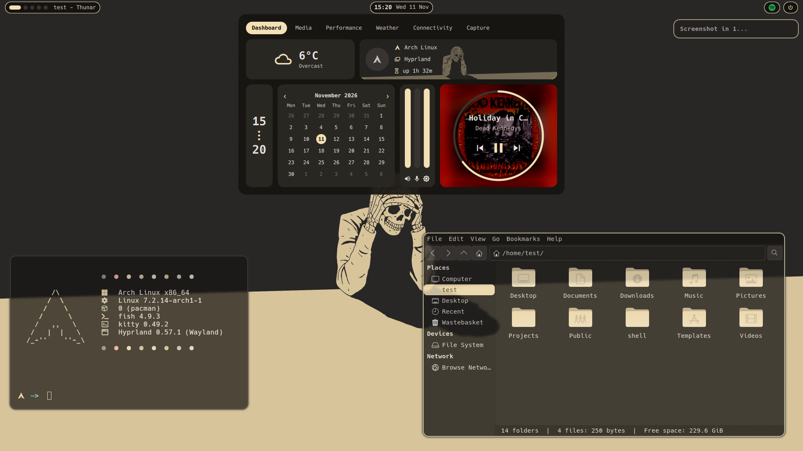
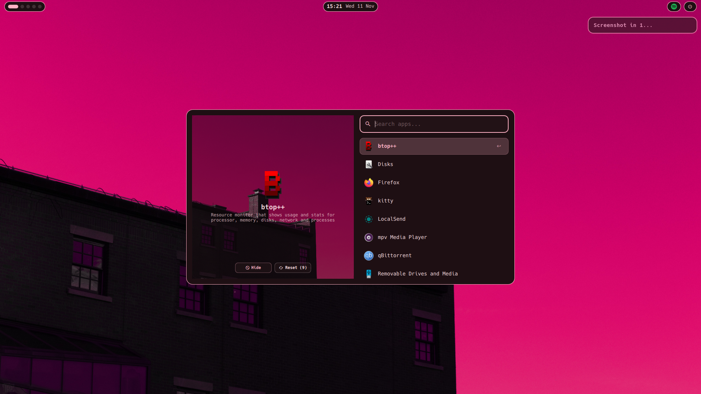

<div align="center">

# 🐚 shell

**Arch Linux · Hyprland · Quickshell · Matugen**

*A minimal Arch setup built around a small Quickshell bar, a tabbed dashboard, and colours generated from your wallpaper.*

---


</div>

<div align="center">




</div>
---

### 🔥 Highlights

* **Wallpaper-driven colours** — pick a wallpaper and **matugen** recolours the whole desktop: Quickshell, GTK 3/4 (Thunar), Kitty, Mako, Hyprland borders, hyprlock, the SDDM login screen, Zed, btop, cava and fastfetch. Grey wallpapers get a monochrome scheme instead of a default blue one.
* **Small bar, big dashboard** — the bar only holds workspaces, window title, clock, a system tray and a power menu. Everything else lives in a tabbed dashboard popup.
* **Folder icons that match** — the Colloid-Dynamic icon theme is recoloured to your accent on every wallpaper change.
* **Smart installer** — detects your GPU (NVIDIA / AMD / Intel), writes the right environment variables, shows one task at a time, and logs everything to `/tmp/saltyfunnels-shell-install-logs`.

---

### 🧩 What's in the shell

| Piece | What it does |
| :--- | :--- |
| **Bar** | Workspace dots, window title, clock, system tray, power menu, and a `REC` indicator while recording (click it to stop) |
| **Dashboard** (click the clock) | **Dashboard** (system info, calendar, mixer, media card) · **Media** (now playing, cava equalizer, spinning album art) · **Performance** (CPU / memory charts, disk, temps, battery) · **Weather** (current + 3-day forecast) · **Connectivity** (Wi-Fi list, Bluetooth devices) · **Capture** (screenshots, screen recording) |
| **Launcher** | App launcher opened with `Super + D` |
| **Wallpaper picker** | Carousel picker opened with `Super + W`; sets the wallpaper and regenerates every colour |
| **Power menu** | Lock, suspend, logout, reboot, shutdown (the destructive ones ask for a second click) |
| **Notifications** | Mako, themed by matugen |
| **System tray** | Icons for apps like Steam, Discord and LocalSend. Left click activates, right click opens the app's menu |
| **Login / lock** | SDDM login screen and hyprlock lock screen, both matugen-themed |
| **Updates** | The dashboard shows a pill with the pending pacman update count; click it to update |

---

### 📦 Software Stack

| Component | Packages |
| :--- | :--- |
| **Desktop** | Hyprland, Quickshell, Hyprpaper, Mako, hyprlock, SDDM, GTK 3/4 |
| **Theming** | matugen, ImageMagick, Colloid-Dynamic icons, Hack Nerd Font |
| **Terminal** | Kitty, Fish, Starship, Fastfetch, Btop |
| **Media & Audio** | Pipewire, Wireplumber, Playerctl, MPV, IMV, Cava |
| **Utilities** | Thunar, Firefox, Spotify, Zed, LocalSend, Gnome Disks, qBittorrent |
| **Gaming** | Steam, Gamemode, MangoHud |

---

### ⚡ Quick Start

Run from your normal user account on a fresh or existing **Arch Linux** (x86-64) install:

```bash
git clone https://github.com/Saltyfunnel/shell
cd shell
chmod +x install.sh
sudo ./install.sh
```

Then reboot and pick the **Hyprland** session at the SDDM login screen. Colours and wallpaper are generated at first login.

Notes:

* Run it with `sudo` from your own user, not from a root login. Your files are installed to that user's home.
* The installer enables `[multilib]` in `/etc/pacman.conf` (needed for Steam).
* Needs **Hyprland 0.55 or newer**. The config is written in Lua.
* If `quickshell` isn't in the official repos, the installer tells you to run `yay -S quickshell` afterwards.
* Wallpapers are cloned from [Saltyfunnel/Wallpapers](https://github.com/Saltyfunnel/Wallpapers) into `~/Pictures/Wallpapers`.
* If something goes wrong after install: `Ctrl + Alt + F2`, then log in.

---

### ⌨️ Keybinds

`Super` is the main modifier.

| Keys | Action |
| :--- | :--- |
| `Super + Return` | Terminal (Kitty) |
| `Super + D` | App launcher |
| `Super + W` | Wallpaper picker |
| `Super + F` | File manager (Thunar) |
| `Super + B` | Browser (Firefox) |
| `Super + C` | Editor (Zed) |
| `Super + I` | System monitor (btop) |
| `Super + S` | Spotify |
| `Super + Q` | Close window |
| `Super + V` | Toggle floating |
| `Super + H / J / K / L` | Focus left / down / up / right |
| `Super + 1–5` | Go to workspace |
| `Super + Shift + 1–5` | Move window to workspace |
| `Super + scroll` | Next / previous workspace |
| `Super + left / right drag` | Move / resize window |
| `Super + Alt + E` | Empty the trash |
| `Super + Escape` | Exit Hyprland |

Volume and media keys work as usual. Screenshots and screen recording are in the dashboard's **Capture** tab.

---

### 🎨 Customising

* **Weather town** — set `weatherTown` in `configs/quickshell/Config.qml`.
* **Colours** — edit the templates in `configs/matugen/templates/`; matugen writes the finished files to each app's real config path (see `configs/matugen/config.toml`). To theme another app, add a template and a `[templates.name]` block.
* **Sizes and animation timings** — `configs/quickshell/Theme.qml`.
* **Keybinds, window rules, animations** — `configs/hypr/hyprland.lua`.
* **Change the wallpaper from a script** — `~/.config/scripts/setwall.sh /path/to/image.jpg` (or `--random`, `--restore`).

---

### 🗂️ Layout

```
install.sh            the installer
configs/
  hypr/               Hyprland (Lua) and hyprpaper
  quickshell/         bar, dashboard, launcher, wallpaper picker
  matugen/            matugen config and all colour templates
  sddm/               login screen theme
  kitty/ fish/ starship/ fastfetch/
scripts/              setwall, screenshot, screen record, icon recolour, SDDM theme install
```
